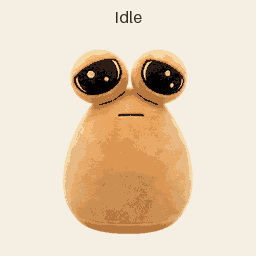

# Pouden 👽

## Русский

Пуп — анимированный плюшевый инопланетянин для Codex, созданный по мотивам игрушки Pouden. В наборе девять состояний анимации. При создании раскадровки использовался ИИ.

**Установка:** скачайте [архив](Pouden-petscodex.zip), распакуйте его в папку `pouden` внутри `%USERPROFILE%\.codex\pets\` (Windows) или `~/.codex/pets/` (macOS). Перезапустите Codex и выберите питомца в настройках внешнего вида.

## English

Pouden is an animated plush alien companion for Codex, inspired by the Pouden toy. The package includes nine animation states. AI was used to create the storyboard.

**Installation:** download the [archive](Pouden-petscodex.zip), extract it into a `pouden` folder under `%USERPROFILE%\.codex\pets\` (Windows) or `~/.codex/pets/` (macOS). Restart Codex and select the pet in the appearance settings.

This is an unofficial fan-made pet and is not affiliated with the original toy's creators.
